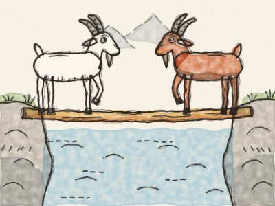
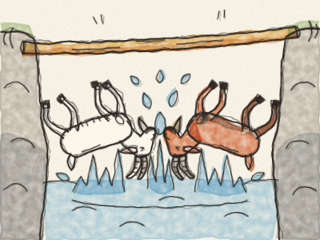

# The Two Goats

Once upon a time, deep in the mountains, a fast little stream ran between two rocky hills. Across the stream lay one narrow log. It was a bridge so thin that only one goat could cross at a time.

One morning, a White Goat stepped onto one end of the log. *Clip, clop.* At the very same moment, a Brown Goat stepped onto the other end. *Clip, clop.* They met right in the middle.

“Move back!” said the White Goat. “I was here first!”

“No, YOU move back!” said the Brown Goat. “I am much more important!”

Neither goat would move. So they lowered their heads and pushed. *Bonk!* They pushed and pushed, *bonk, bonk,* until the log wobbled, and — *SPLASH!* — both goats fell into the cold water.

They climbed out, dripping and shivering, on opposite sides. *Brrr!*

The next morning, they met in the middle of the log again. The White Goat opened her mouth to shout… and then she stopped. “Wait,” she said. “Let’s not do yesterday again.”

“Good idea,” said the Brown Goat. And he lay down flat on the log. The White Goat stepped over him, very carefully. *Clip… clop.* Then he got up, and they both went on their way, dry and happy.

> When nobody gives way, everybody gets wet. A little kindness lets everyone across.
