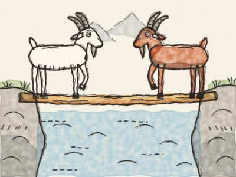
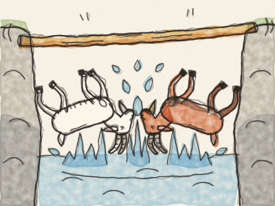

# Les Deux Chèvres

Il était une fois, tout là-haut dans les montagnes, un petit ruisseau rapide qui coulait entre deux collines pleines de rochers. Au-dessus du ruisseau, il y avait un seul tronc d’arbre, tout étroit. C’était un pont si mince qu’une seule chèvre à la fois pouvait passer.

Un matin, une Chèvre blanche posa le sabot sur un bout du tronc. *Clip, clop.* Au même moment, une Chèvre brune posa le sabot sur l’autre bout. *Clip, clop.* Elles se retrouvèrent juste au milieu.

« Recule ! » dit la Chèvre blanche. « J’étais là la première ! »

« Non, c’est TOI qui recules ! » dit la Chèvre brune. « Je suis bien plus importante ! »

Aucune des deux ne voulait bouger. Alors elles baissèrent la tête et poussèrent. *Bong !* Elles poussèrent, poussèrent, *bong, bong,* tant et si bien que le tronc se mit à trembler, et — *PLOUF !* — les deux chèvres tombèrent dans l’eau froide.

Elles sortirent toutes trempées et grelottantes, chacune de son côté. *Brrr !*

Le lendemain matin, elles se retrouvèrent encore au milieu du tronc. La Chèvre blanche ouvrit la bouche pour crier… puis elle s’arrêta. « Attends », dit-elle. « Ne recommençons pas comme hier. »

« Bonne idée », dit la Chèvre brune. Et elle se coucha à plat sur le tronc. La Chèvre blanche l’enjamba, tout doucement. *Clip… clop.* Puis la Chèvre brune se releva, et chacune continua son chemin, bien au sec et contente.

> Quand personne ne cède, tout le monde se mouille. Un peu de gentillesse, et chacun peut passer.
