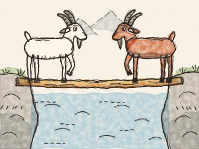
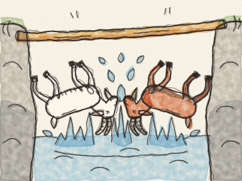

# As Duas Cabras

Era uma vez, lá no alto das montanhas, um ribeiro pequenino e apressado que corria entre dois montes cheios de pedras. Por cima do ribeiro havia um só tronco de árvore, muito estreito. Era uma ponte tão fininha que só uma cabra de cada vez podia passar.

Certa manhã, uma Cabra branca pôs a pata numa ponta do tronco. *Clip, clop.* No mesmo instante, uma Cabra castanha pôs a pata na outra ponta. *Clip, clop.* Encontraram-se mesmo a meio.

— Para trás! — disse a Cabra branca. — Eu cheguei primeiro!

— Não, para trás vais TU! — disse a Cabra castanha. — Eu sou muito mais importante!

Nenhuma das duas queria sair do lugar. Então baixaram a cabeça e empurraram. *Pum!* Empurraram, empurraram, *pum, pum,* até o tronco começar a abanar, e — *CHAPE!* — as duas cabras caíram na água fria.

Saíram todas encharcadas e a tremer, cada uma para o seu lado. *Brrr!*

Na manhã seguinte, voltaram a encontrar-se a meio do tronco. A Cabra branca abriu a boca para gritar… e depois parou. — Espera — disse ela. — Não vamos fazer como ontem.

— Boa ideia — disse a Cabra castanha. E deitou-se toda esticada no tronco. A Cabra branca passou por cima dela, com muito cuidado. *Clip… clop.* Depois a Cabra castanha levantou-se, e cada uma seguiu o seu caminho, sequinha e feliz.

> Quando ninguém cede, ficam todos molhados. Um pouco de gentileza deixa todos passar.
