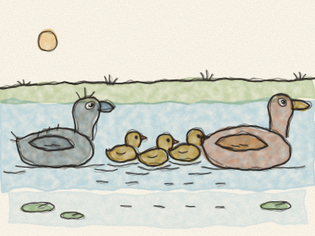
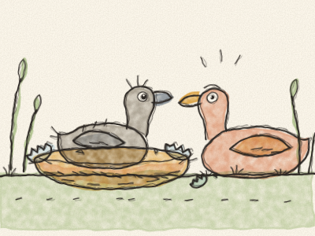
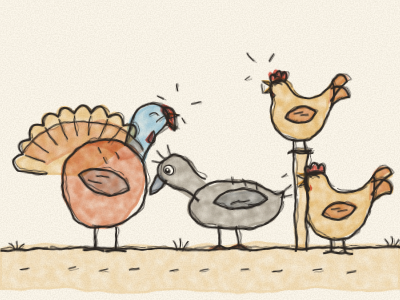
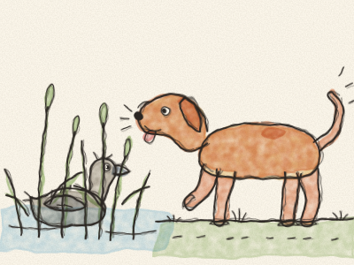
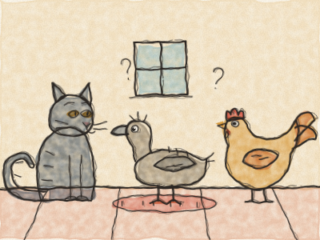
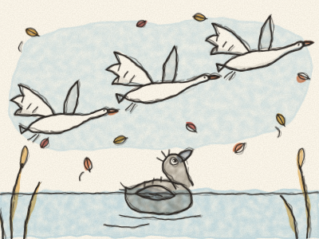
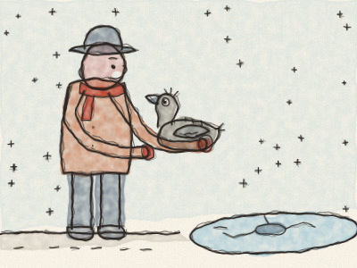
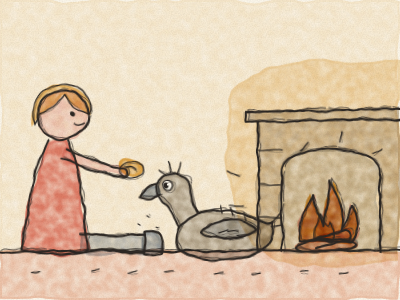
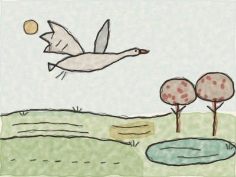
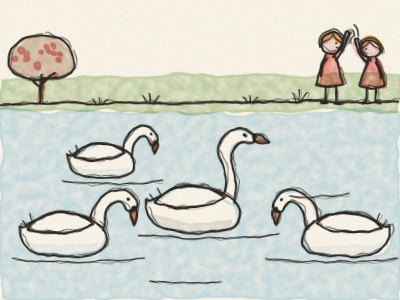

# The Ugly Duckling

It was summer in the countryside. The wheat was golden, the hay smelt sweet, and down by the old farm there was a quiet pond, with tall green reeds all around it.

In the reeds, a Mother Duck sat on her nest. She had been sitting on her eggs for days and days, keeping them warm. “Oh, when will my babies come out?” she sighed. “It’s taking so long!”

At last — *crack! crack! crack!* — the eggs began to open. Out popped one little head, then another, then another. “Peep! Peep! Peep!” said the ducklings, all yellow and fluffy. “How big the world is!”

“Wait,” said Mother Duck. “There’s still one egg left.” It was the biggest egg of all.

So she sat down again, and she waited, and she waited. Then, at last — *CRACK!* — out tumbled the last duckling.

But he wasn’t small. And he wasn’t yellow. He was big, and grey, and his feet were very large.

“Goodness me,” said Mother Duck. “What a big, grey baby! He doesn’t look like the others at all.”

The next morning, she led all her babies down to the pond. *Splish!* In she went. “Quack! Come along!” *Splosh! Splosh! Splosh!* In went the ducklings, one after the other. And the big grey duckling swam best of all, straight and strong.

“Well,” said Mother Duck, “he may be strange, but he swims beautifully. He is my own child after all.”

Then Mother Duck took her ducklings to meet the animals of the farmyard. But the farmyard animals were not kind.

“Look at that one!” clucked the Hens. “How big and clumsy he is!”

“Gobble-gobble!” said the Turkey, puffing himself up like a ship with all its sails. “He’s much too ugly. We don’t want him here!”

Even his own brothers and sisters pecked at him. “Go away, ugly duckling!” they peeped.

The poor duckling hung his head. Every day it was the same. They laughed at him, they pushed him, and nobody wanted to play with him. “It’s because I am so ugly,” he thought sadly.

So one morning, very early, he slipped through a hole in the hedge and ran away.

He ran and ran until he came to a wide, wild marsh where the wild ducks lived. He was so tired that he lay down in the reeds and slept all night.

In the morning, the wild ducks came to look at him. “What kind of bird are you?” they asked. “You are very ugly. But you may stay, as long as you don’t bother us.”

Then — *woof! woof!* — a big brown dog came splashing through the marsh. The duckling hid in the reeds and kept very, very still. The dog put his wet nose right up to him… *sniff, sniff*… and then trotted away.

“Oh,” sighed the duckling, “I am so ugly that even the dog doesn’t want me.”

The duckling went on, over fields and through woods, until the evening, when he came to a little old cottage. The door was open just a crack, so he crept inside, out of the wind.

An old woman lived there, with her Cat and her Hen. The Cat could arch his back and purr. The Hen could lay eggs.

“Can you purr?” asked the Cat.

“No,” said the duckling.

“Can you lay eggs?” asked the Hen.

“No,” said the duckling. “But I love to swim. It’s so lovely to dive down to the bottom of the water!”

“Swim? What a silly idea!” laughed the Cat and the Hen. “Nobody wants to do that.”

So the duckling went away again, to find some water.

Autumn came. The leaves turned yellow and brown, and the wind blew them round and round. The clouds were heavy and grey.

One evening, as the sun went down, the duckling was swimming alone on a lake. Suddenly, out of the reeds, rose a flock of the most beautiful birds he had ever seen. They were white, shining white, with long, graceful necks.

They spread their great wings and flew away high into the sky, to warmer lands far in the south. *Whoosh, whoosh, whoosh.*

The duckling turned round and round in the water, stretched out his neck, and called after them, with a strange, loud cry. He didn’t know who they were. But he loved them more than anything in the world.

Then winter came, cold, cold winter. The snow fell, and the lake began to freeze. Every night, the hole of water where the duckling swam grew smaller and smaller, and he had to paddle and paddle to keep it open.

One morning, he was so tired that he stopped paddling, and the ice closed tight around him. He was stuck!

Just then, a farmer came by. He saw the little grey bird caught in the ice. *Crack! Crack!* He broke the ice with his boot, lifted out the duckling, and tucked him inside his warm coat.

“There, there, little one,” said the farmer kindly. “You’ll come home with me.”

At the farmer’s house, there was a big fire, crackling and popping. The farmer’s wife wrapped the duckling in a soft blanket, and the children gave him bread and water.

At first, the duckling was frightened, and he flapped his wings and knocked over a jug of milk. *Splash!* But nobody shouted. The children laughed, and wiped it up, and stroked his feathers gently.

So all winter long, the duckling stayed by the warm fire, while the snow fell outside. He ate, and he slept, and he grew. And his feathers began, very slowly, to change.

Then one day the sun shone, the birds sang, and the snow melted away. Spring had come!

The children opened the door. The duckling spread his wings, and they were big now, and strong. *Whoosh!* Up he went, high into the sky, over the farm, over the green fields full of flowers.

He flew until he saw a beautiful garden, with apple trees in blossom and a lake shining in the sun. And on the lake, three of those wonderful white birds were swimming towards him.

The duckling landed on the water. He was afraid. “They will chase me away,” he thought, “because I am so ugly. But I don’t mind. I just want to be near them.”

So he bowed his head down to the water… and then he saw his reflection.

He wasn’t a clumsy grey duckling any more. He was white, shining white, with a long, graceful neck. He was a swan!

The three swans swam all round him and gently stroked him with their beaks. “Welcome, brother,” they said.

Some children came running down to the lake with bread. “Look!” they cried. “There’s a new swan! And the new one is the most beautiful of all!”

The young swan ruffled his feathers and lifted his neck. He was very happy, but he was not proud, because he remembered what it felt like to be laughed at. And he said to himself, “I never dreamed of so much happiness, when I was the ugly duckling.”

> Being different is not being ugly. Be kind to everyone: you never know who will turn into a swan.
