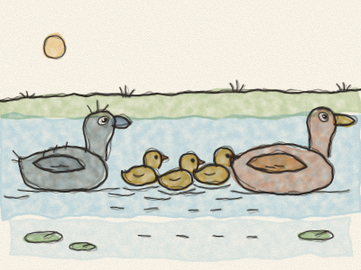
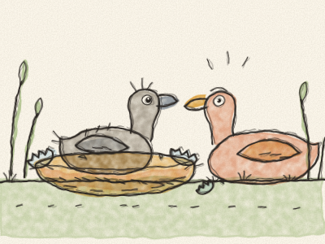
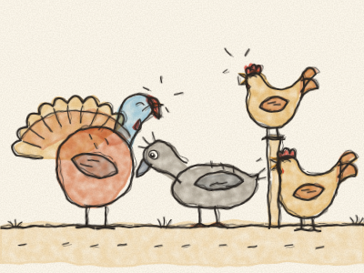
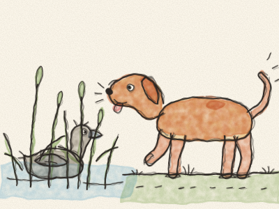
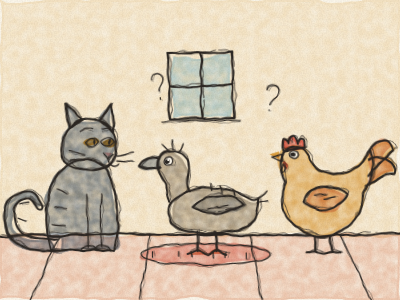
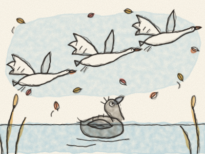
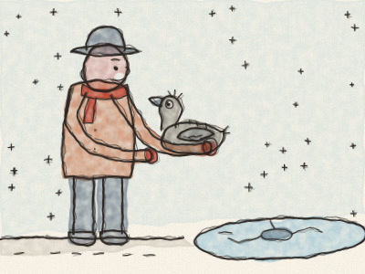
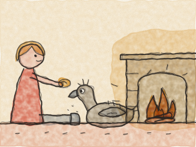
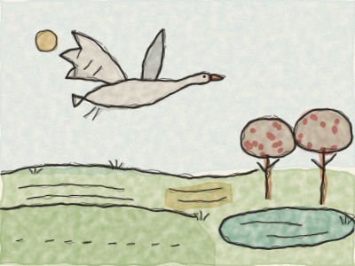
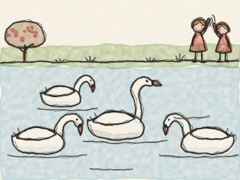

# Le Vilain Petit Canard

C’était l’été à la campagne. Le blé était doré, le foin sentait bon, et près de la vieille ferme il y avait une mare tranquille, entourée de grands roseaux verts.

Dans les roseaux, une Maman Cane couvait son nid. Depuis des jours et des jours, elle gardait ses œufs bien au chaud. « Oh, quand mes petits vont-ils sortir ? » soupira-t-elle. « C’est si long ! »

Enfin — *crac ! crac ! crac !* — les œufs commencèrent à s’ouvrir. Une petite tête sortit, puis une autre, puis une autre. « Piou ! Piou ! Piou ! » firent les canetons, tout jaunes et tout duveteux. « Comme le monde est grand ! »

« Attendez », dit Maman Cane. « Il reste encore un œuf. » C’était le plus gros œuf de tous.

Alors elle se rassit, et elle attendit, attendit. Puis, enfin — *CRAC !* — le dernier caneton dégringola de sa coquille.

Mais il n’était pas petit. Et il n’était pas jaune. Il était grand, et gris, et il avait de très grandes pattes.

« Ça alors », dit Maman Cane. « Quel grand bébé tout gris ! Il ne ressemble pas du tout aux autres. »

Le lendemain matin, elle emmena tous ses petits à la mare. *Plouf !* Elle entra dans l’eau. « Coin ! Venez ! » *Plouf ! Plouf ! Plouf !* Les canetons sautèrent l’un après l’autre. Et le grand caneton gris nageait mieux que tous, bien droit et bien fort.

« Eh bien », dit Maman Cane, « il est peut-être bizarre, mais il nage merveilleusement. Et c’est mon enfant, après tout. »

Puis Maman Cane emmena ses canetons rencontrer les animaux de la basse-cour. Mais les animaux de la basse-cour n’étaient pas gentils.

« Regardez celui-là ! » caquetèrent les Poules. « Qu’il est grand et maladroit ! »

« Glou-glou ! » fit le Dindon, en se gonflant comme un bateau toutes voiles dehors. « Il est bien trop laid. Nous ne voulons pas de lui ici ! »

Même ses frères et sœurs le picoraient. « Va-t’en, vilain petit canard ! » piaillaient-ils.

Le pauvre caneton baissa la tête. Chaque jour, c’était pareil. On se moquait de lui, on le bousculait, et personne ne voulait jouer avec lui. « C’est parce que je suis si laid », pensa-t-il tristement.

Alors un matin, très tôt, il se glissa par un trou de la haie et s’enfuit.

Il courut, courut, jusqu’à un grand marais sauvage où vivaient les canards sauvages. Il était si fatigué qu’il se coucha dans les roseaux et dormit toute la nuit.

Le matin, les canards sauvages vinrent le regarder. « Quelle sorte d’oiseau es-tu ? » demandèrent-ils. « Tu es très laid. Mais tu peux rester, tant que tu ne nous déranges pas. »

Puis — *ouaf ! ouaf !* — un gros chien marron arriva en éclaboussant tout le marais. Le caneton se cacha dans les roseaux et ne bougea plus du tout. Le chien approcha sa truffe mouillée tout près de lui… *snif, snif*… puis s’en alla en trottinant.

« Oh », soupira le caneton, « je suis si laid que même le chien ne veut pas de moi. »

Le caneton repartit, à travers champs et à travers bois, jusqu’au soir, où il arriva devant une petite chaumière. La porte était entrouverte, alors il se faufila à l’intérieur, à l’abri du vent.

Une vieille femme vivait là, avec son Chat et sa Poule. Le Chat savait faire le gros dos et ronronner. La Poule savait pondre des œufs.

« Sais-tu ronronner ? » demanda le Chat.

« Non », dit le caneton.

« Sais-tu pondre des œufs ? » demanda la Poule.

« Non », dit le caneton. « Mais j’adore nager. C’est si bon de plonger jusqu’au fond de l’eau ! »

« Nager ? Quelle idée bizarre ! » rirent le Chat et la Poule. « Personne n’a envie de faire ça. »

Alors le caneton repartit, pour trouver de l’eau.

L’automne arriva. Les feuilles devinrent jaunes et brunes, et le vent les faisait tourbillonner. Les nuages étaient lourds et gris.

Un soir, au coucher du soleil, le caneton nageait tout seul sur un lac. Soudain, des roseaux s’envolèrent les plus beaux oiseaux qu’il eût jamais vus. Ils étaient blancs, d’un blanc éclatant, avec un long cou gracieux.

Ils déployèrent leurs grandes ailes et s’envolèrent très haut dans le ciel, vers les pays chauds, loin dans le sud. *Fouou, fouou, fouou.*

Le caneton tourna et tourna dans l’eau, tendit le cou, et les appela d’un cri étrange et puissant. Il ne savait pas qui ils étaient. Mais il les aimait plus que tout au monde.

Puis l’hiver arriva, un hiver froid, très froid. La neige tomba, et le lac commença à geler. Chaque nuit, le trou d’eau où nageait le caneton devenait plus petit, et il devait pagayer et pagayer pour le garder ouvert.

Un matin, il était si fatigué qu’il s’arrêta de pagayer, et la glace se referma tout autour de lui. Il était coincé !

Juste à ce moment-là, un fermier passa. Il vit le petit oiseau gris prisonnier de la glace. *Crac ! Crac !* Il brisa la glace avec sa botte, sortit le caneton et le blottit dans son manteau bien chaud.

« Là, là, mon petit », dit gentiment le fermier. « Tu vas venir à la maison avec moi. »

Chez le fermier, il y avait un grand feu qui crépitait. La femme du fermier enveloppa le caneton dans une couverture toute douce, et les enfants lui donnèrent du pain et de l’eau.

D’abord, le caneton eut peur : il battit des ailes et renversa un pot de lait. *Splash !* Mais personne ne cria. Les enfants rirent, essuyèrent tout, et caressèrent doucement ses plumes.

Alors tout l’hiver, le caneton resta près du feu bien chaud, pendant que la neige tombait dehors. Il mangea, il dormit, et il grandit. Et ses plumes commencèrent, tout doucement, à changer.

Puis un jour, le soleil brilla, les oiseaux chantèrent, et la neige fondit. Le printemps était arrivé !

Les enfants ouvrirent la porte. Le caneton déploya ses ailes : elles étaient grandes maintenant, et fortes. *Fouou !* Il s’envola très haut dans le ciel, au-dessus de la ferme, au-dessus des champs verts pleins de fleurs.

Il vola jusqu’à un beau jardin, avec des pommiers en fleurs et un lac qui brillait au soleil. Et sur le lac, trois de ces merveilleux oiseaux blancs nageaient vers lui.

Le caneton se posa sur l’eau. Il avait peur. « Ils vont me chasser », pensa-t-il, « parce que je suis si laid. Mais tant pis. Je veux juste être près d’eux. »

Alors il pencha la tête vers l’eau… et il vit son reflet.

Ce n’était plus un caneton gris et maladroit. Il était blanc, d’un blanc éclatant, avec un long cou gracieux. C’était un cygne !

Les trois cygnes nagèrent tout autour de lui et le caressèrent doucement de leur bec. « Bienvenue, petit frère », dirent-ils.

Des enfants arrivèrent en courant au bord du lac avec du pain. « Regardez ! » crièrent-ils. « Il y a un nouveau cygne ! Et le nouveau est le plus beau de tous ! »

Le jeune cygne gonfla ses plumes et leva le cou. Il était très heureux, mais il n’était pas fier, car il se souvenait de ce que l’on ressent quand on se moque de vous. Et il se dit : « Je n’avais jamais rêvé d’un tel bonheur, quand j’étais le vilain petit canard. »

> Être différent, ce n’est pas être laid. Sois gentil avec tout le monde : on ne sait jamais qui deviendra un cygne.
