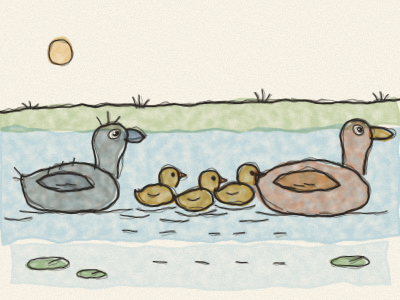
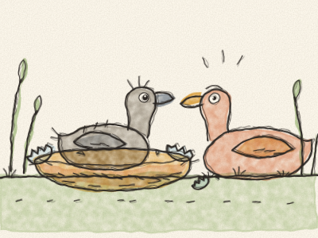
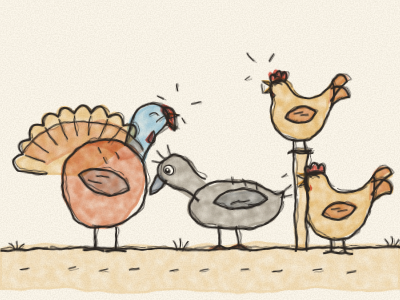
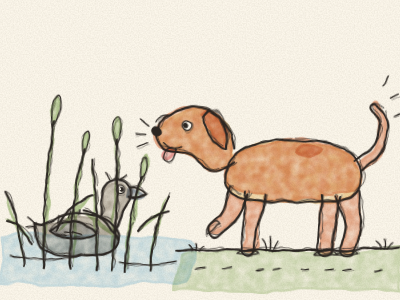
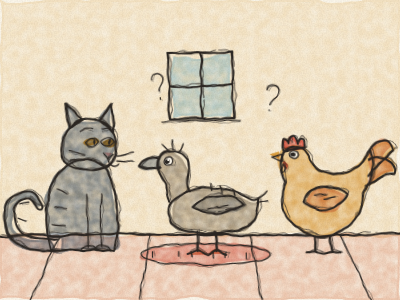
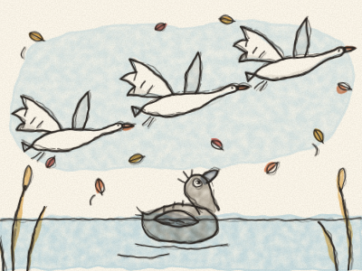
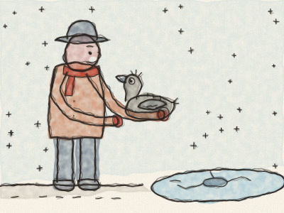
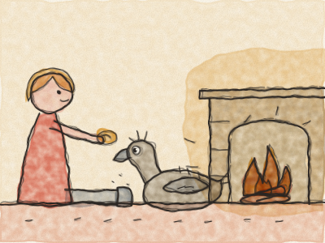
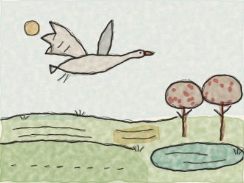
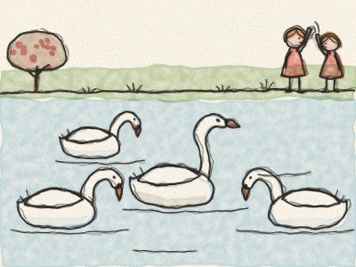

# O Patinho Feio

Era verão no campo. O trigo estava dourado, o feno cheirava bem, e ao pé da velha quinta havia um lago sossegado, rodeado de juncos altos e verdes.

No meio dos juncos, uma Mãe Pata estava sentada no ninho. Há dias e dias que chocava os ovos, para os manter quentinhos. — Ai, quando é que os meus filhotes vão sair? — suspirou ela. — Está a demorar tanto!

Por fim — *crac! crac! crac!* — os ovos começaram a abrir-se. Saiu uma cabecinha, depois outra, depois mais outra. — Piu! Piu! Piu! — disseram os patinhos, todos amarelos e fofinhos. — Como o mundo é grande!

— Esperem — disse a Mãe Pata. — Ainda falta um ovo. — Era o maior ovo de todos.

Então ela voltou a sentar-se, e esperou, esperou. Até que, por fim — *CRAC!* — o último patinho saiu aos trambolhões.

Mas não era pequeno. E não era amarelo. Era grande, e cinzento, e tinha umas patas enormes.

— Ora esta! — disse a Mãe Pata. — Que bebé tão grande e tão cinzento! Não se parece nada com os outros.

Na manhã seguinte, levou todos os filhotes até ao lago. *Chape!* Lá foi ela para a água. — Quá! Venham! *Chape! Chape! Chape!* Os patinhos saltaram, um atrás do outro. E o patinho grande e cinzento era o que nadava melhor, direitinho e com força.

— Bem — disse a Mãe Pata —, pode ser esquisito, mas nada lindamente. E afinal é meu filho.

Depois a Mãe Pata levou os patinhos a conhecer os animais do galinheiro. Mas os animais do galinheiro não eram simpáticos.

— Olhem para aquele! — cacarejaram as Galinhas. — Tão grande e tão desajeitado!

— Glu-glu! — fez o Peru, a inchar-se todo como um barco de velas abertas. — É feio demais. Não o queremos cá!

Até os irmãos e as irmãs lhe davam bicadas. — Vai-te embora, patinho feio! — piavam eles.

O pobre patinho baixou a cabeça. Todos os dias era a mesma coisa. Riam-se dele, empurravam-no, e ninguém queria brincar com ele. — É porque sou tão feio — pensava ele, triste.

Então, uma manhã, muito cedo, esgueirou-se por um buraco na sebe e fugiu.

Correu e correu até chegar a um grande pântano selvagem, onde viviam os patos-bravos. Estava tão cansado que se deitou nos juncos e dormiu a noite inteira.

De manhã, os patos-bravos vieram olhar para ele. — Que pássaro és tu? — perguntaram. — És muito feio. Mas podes ficar, desde que não nos incomodes.

Depois — *ão! ão!* — um cão grande e castanho veio a chapinhar pelo pântano. O patinho escondeu-se nos juncos e ficou muito, muito quieto. O cão encostou o focinho molhado mesmo ao pé dele… *snif, snif*… e depois foi-se embora a trotar.

— Ai — suspirou o patinho —, sou tão feio que nem o cão me quer.

O patinho continuou o caminho, por campos e por bosques, até à noite, quando chegou a uma casinha velha. A porta estava entreaberta, por isso entrou de mansinho, para se abrigar do vento.

Ali vivia uma velhinha, com o seu Gato e a sua Galinha. O Gato sabia arquear as costas e ronronar. A Galinha sabia pôr ovos.

— Sabes ronronar? — perguntou o Gato.

— Não — disse o patinho.

— Sabes pôr ovos? — perguntou a Galinha.

— Não — disse o patinho. — Mas adoro nadar. É tão bom mergulhar até ao fundo da água!

— Nadar? Que ideia tão tonta! — riram-se o Gato e a Galinha. — Ninguém quer fazer isso.

Então o patinho foi-se embora outra vez, à procura de água.

Chegou o outono. As folhas ficaram amarelas e castanhas, e o vento fazia-as rodopiar. As nuvens estavam pesadas e cinzentas.

Uma tarde, ao pôr do sol, o patinho nadava sozinho num lago. De repente, do meio dos juncos, levantaram voo as aves mais bonitas que ele alguma vez tinha visto. Eram brancas, de um branco brilhante, com pescoços compridos e elegantes.

Abriram as grandes asas e voaram muito alto no céu, para terras quentes, lá longe no sul. *Fuu, fuu, fuu.*

O patinho deu voltas e voltas na água, esticou o pescoço e chamou por elas, com um grito estranho e forte. Não sabia quem elas eram. Mas gostava delas mais do que de tudo no mundo.

Depois chegou o inverno, um inverno frio, muito frio. A neve caiu, e o lago começou a gelar. Todas as noites, o buraco de água onde o patinho nadava ficava mais pequeno, e ele tinha de remar e remar para o manter aberto.

Uma manhã, estava tão cansado que parou de remar, e o gelo fechou-se à volta dele. Estava preso!

Nesse momento, passou um lavrador. Viu o passarinho cinzento preso no gelo. *Crac! Crac!* Partiu o gelo com a bota, tirou o patinho e aconchegou-o dentro do casaco quentinho.

— Pronto, pronto, pequenino — disse o lavrador com carinho. — Vens para casa comigo.

Em casa do lavrador havia uma grande lareira, a estalar e a crepitar. A mulher do lavrador embrulhou o patinho numa manta macia, e as crianças deram-lhe pão e água.

Primeiro o patinho teve medo: bateu as asas e entornou uma bilha de leite. *Chape!* Mas ninguém ralhou. As crianças riram-se, limparam tudo e fizeram-lhe festinhas nas penas.

E assim, durante todo o inverno, o patinho ficou ao pé da lareira quentinha, enquanto a neve caía lá fora. Comeu, dormiu e cresceu. E as penas começaram, muito devagarinho, a mudar.

Até que um dia o sol brilhou, os pássaros cantaram e a neve derreteu. Tinha chegado a primavera!

As crianças abriram a porta. O patinho abriu as asas, e elas agora eram grandes e fortes. *Fuu!* Lá foi ele, muito alto no céu, por cima da quinta, por cima dos campos verdes cheios de flores.

Voou até ver um jardim muito bonito, com macieiras em flor e um lago a brilhar ao sol. E no lago, três daquelas aves brancas maravilhosas nadavam na direção dele.

O patinho pousou na água. Tinha medo. — Vão enxotar-me — pensou ele —, porque sou tão feio. Mas não faz mal. Só quero estar perto delas.

Então baixou a cabeça até à água… e viu o seu reflexo.

Já não era um patinho cinzento e desajeitado. Era branco, de um branco brilhante, com um pescoço comprido e elegante. Era um cisne!

Os três cisnes nadaram à volta dele e fizeram-lhe festinhas com o bico. — Bem-vindo, irmão — disseram.

Umas crianças vieram a correr até ao lago, com pão. — Olhem! — gritaram. — Há um cisne novo! E o novo é o mais bonito de todos!

O jovem cisne eriçou as penas e levantou o pescoço. Estava muito feliz, mas não era vaidoso, porque se lembrava de como era triste quando se riam dele. E disse para si mesmo: — Nunca sonhei com tanta felicidade, quando era o patinho feio.

> Ser diferente não é ser feio. Sê bondoso com todos: nunca se sabe quem se vai transformar num cisne.
