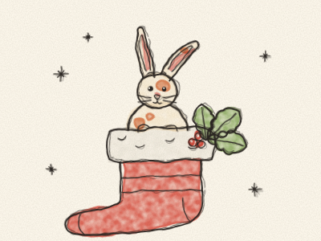
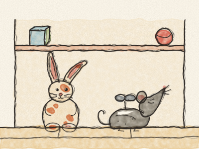
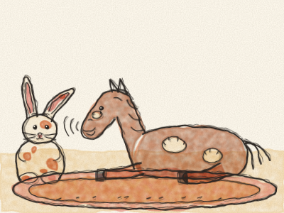
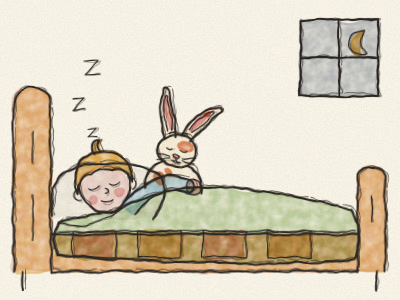
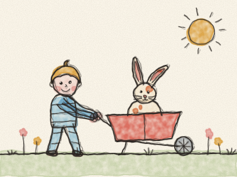
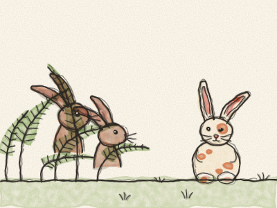
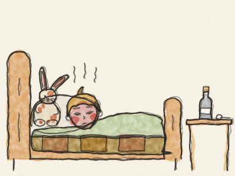
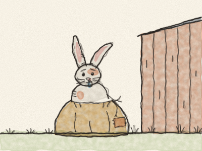
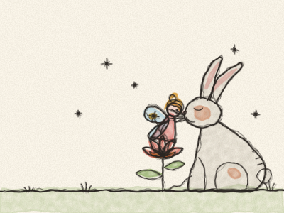

# The Velveteen Rabbit

There was once a velveteen rabbit, and in the beginning he was really splendid. He was fat and bunchy, as a rabbit should be. His coat was spotted brown and white, he had real thread whiskers, and his ears were lined with pink satin. On Christmas morning, he sat at the very top of the Boy’s stocking, with a sprig of holly between his paws.

The Boy loved him — for two whole hours. Then the aunts and uncles came to dinner, there was a great rustling of paper and ribbons, and in all the excitement the Velveteen Rabbit was forgotten.

For a long time he lived in the toy cupboard, or on the nursery floor, and nobody thought very much about him. The mechanical toys were very proud. They had springs inside them, and they went *whirr, whirr, whirr* when you wound them up.

“You’re only stuffed with sawdust,” said the clockwork mouse, with his nose in the air. “You haven’t even got a key.” And the little Rabbit felt very small and very plain.

The only one who was kind to him was the Skin Horse. The Skin Horse had lived in the nursery longer than anyone. He was so old that his brown coat was bald in patches, and most of the hairs in his tail had been pulled out to string bead necklaces. But he was wise.

“What is Real?” asked the Rabbit one day, as they lay side by side near the nursery fire. “Does it mean having things that buzz inside you, and a handle that sticks out?”

“Real isn’t how you are made,” said the Skin Horse. “It’s a thing that happens to you. When a child loves you for a long, long time — not just to play with, but REALLY loves you — then you become Real.”

“Does it hurt?” asked the Rabbit.

“Sometimes,” said the Skin Horse, for he always told the truth. “By the time you are Real, most of your fur has been loved off, your eyes drop out and you get loose in the joints. But these things don’t matter at all, because once you are Real, you can’t be ugly, except to people who don’t understand.”

The Rabbit sighed. He wished he could become Real too, without the uncomfortable bits.

One evening, the Boy couldn’t find the china dog that always slept with him. Nana was in a hurry, so she opened the toy cupboard and pulled out the first thing she found. “Here,” she said, “take your old Bunny. He’ll do to sleep with you!” And she tucked the Rabbit into the Boy’s bed.

That night, and for many nights after, the Velveteen Rabbit slept in the Boy’s bed. At first he found it rather uncomfortable, for the Boy hugged him very tight, and sometimes rolled over on him, and sometimes pushed him so far under the pillow that he could hardly breathe. But soon he grew to like it, because the Boy talked to him, and made lovely tunnels for him under the blankets, like the burrows real rabbits live in.

Spring came, and they had long days in the garden. Wherever the Boy went, the Rabbit went too. He had rides in the wheelbarrow, and picnics on the grass, and the Boy built him lovely little houses under the raspberry canes.

He was so happy that he never noticed how his beautiful velvet fur was getting shabbier and shabbier, how his tail was coming unsewn, and how all the pink had rubbed off his nose where the Boy had kissed him.

One evening, the Boy left him out on the lawn, and Nana had to go and look for him with a candle, because the Boy couldn’t go to sleep without him. “Fancy all that fuss for a toy!” she grumbled.

The Boy sat up in bed. “He isn’t a toy,” he said. “He’s REAL!”

When the little Rabbit heard that, he was happy, for he knew that what the Skin Horse had said was true at last. That night he was almost too happy to sleep.

One summer evening, while the Boy was playing nearby, two strange rabbits crept out of the tall bracken. They were brown and furry and very new-looking. Their seams didn’t show at all, and they changed shape in the oddest way when they moved.

“Why don’t you get up and play with us?” said one. “Can you hop on your hind legs?”

“I don’t want to,” said the little Rabbit, for he didn’t want them to know that he had no hind legs at all, only one smooth piece, like a pincushion.

The wild rabbit sniffed him all over and jumped back. “He doesn’t smell right!” he cried. “He isn’t a rabbit at all! He isn’t real!” And *flick, flick*, they were gone.

“I am Real!” said the little Rabbit. “The Boy said so!” And he waited a long time for them to come back, but they never did.

Then, one day, the Boy fell ill. His face grew very hot, and he had to stay in bed for many, many days. The little Rabbit stayed beside him under the blankets the whole time, and whispered to him about the garden and the raspberry canes and all the fine games they would play when he was better.

And slowly, the Boy did get better. The doctor said he should go to the seaside to breathe the fresh sea air. “Hurrah!” said the Boy.

“But all these old books and toys must go,” said the doctor. “They’re full of germs.”

So the little Rabbit was put into a sack with some old picture books, and carried down to the bottom of the garden, behind the shed. And that night the Boy slept with a brand-new rabbit, and he was far too excited about the seaside to think about his old Bunny.

The little Rabbit wriggled out of the top of the sack and looked around. He felt very lonely. He thought about the Boy, and the long sunny days in the garden. “What use is it to be loved,” he thought, “if it all ends like this?” And a tear, a real tear, trickled down his shabby velvet nose and fell to the ground.

And then a strange thing happened. Where the tear had fallen, a flower grew out of the ground — a beautiful flower, not like any other in the garden. Its petals opened, and out stepped a tiny fairy, dressed in dewdrops and moonlight.

She took the little Rabbit gently in her arms and kissed him on his velveteen nose. “Little Rabbit,” she said, “don’t you know who I am? I am the nursery magic Fairy. I take care of all the playthings that children have loved. When they are old and worn out, I come and take them away, and I make them Real.”

“Wasn’t I Real before?” asked the Rabbit.

“You were Real to the Boy,” said the Fairy, “because he loved you. Now you shall be Real to everyone.”

She flew with him into the wood, where the wild rabbits were dancing in the moonlight, and set him down on the soft grass. “Run and play, little Rabbit!” she said.

He sat very still for a moment. Then something tickled his nose, and before he knew it, he lifted a hind foot to scratch it. He had hind legs! Real ones! He gave one jump, *hop!*, and then another, *hop, hop!*, and away he went with the other rabbits. He was a Real Rabbit at last.

Autumn passed, and winter. In the spring, when the Boy came back to play in the garden, two rabbits crept out of the bracken to look at him. One of them had brown and white spots, and something about his eyes looked very familiar.

“Why,” thought the Boy, “he looks just like my old Bunny!”

But he never knew that it really was his own Bunny, come back to look at the child who had first helped him to be Real.

> Love is what makes us Real. The things we love most are never ugly, however worn they get.
