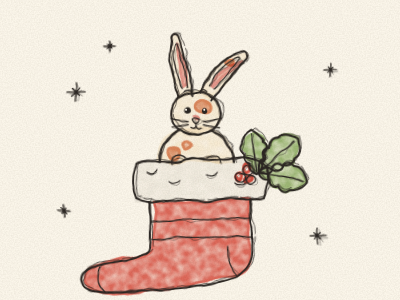
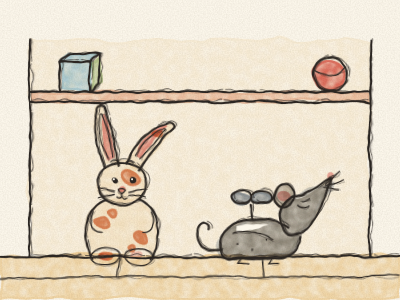
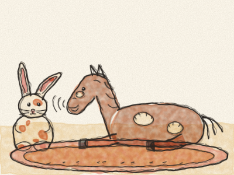
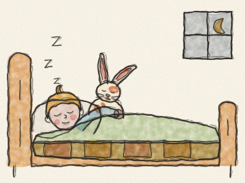
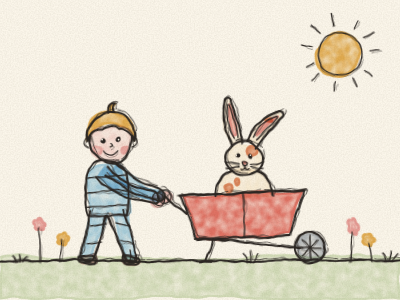
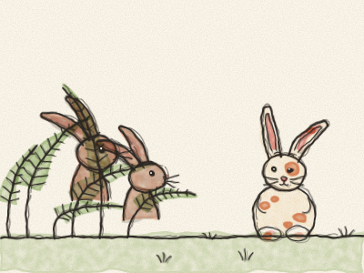
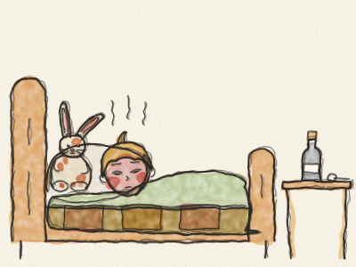
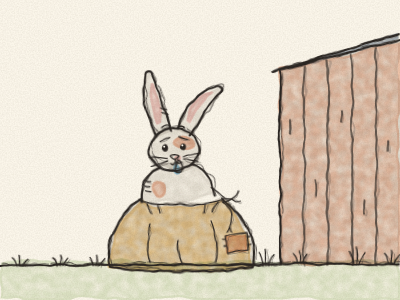
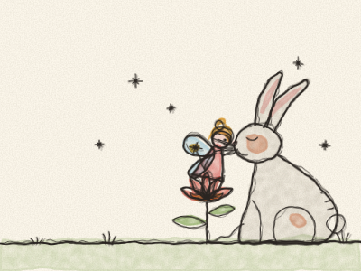

# Le Lapin de velours

Il était une fois un lapin de velours, et au début, il était vraiment magnifique. Il était bien dodu et tout rebondi, comme doit l’être un lapin. Son pelage était tacheté de brun et de blanc, il avait de vraies moustaches en fil, et ses oreilles étaient doublées de satin rose. Le matin de Noël, il était assis tout en haut de la chaussette du Petit Garçon, avec un brin de houx entre les pattes.

Le Petit Garçon l’aima — pendant deux heures entières. Puis les tantes et les oncles arrivèrent pour le déjeuner, il y eut un grand froissement de papiers et de rubans, et dans toute cette agitation, le Lapin de velours fut oublié.

Pendant longtemps, il vécut dans le placard à jouets, ou sur le plancher de la chambre d’enfant, et personne ne pensait beaucoup à lui. Les jouets mécaniques étaient très fiers. Ils avaient des ressorts à l’intérieur, et ils faisaient *vrrr, vrrr, vrrr* quand on les remontait.

« Tu n’es rempli que de sciure », dit la souris mécanique, le nez en l’air. « Tu n’as même pas de clé. » Et le petit Lapin se sentit tout petit et tout ordinaire.

Le seul qui était gentil avec lui, c’était le Cheval de cuir. Le Cheval de cuir vivait dans la chambre d’enfant depuis plus longtemps que tout le monde. Il était si vieux que son pelage brun était pelé par endroits, et qu’on avait arraché presque tous les crins de sa queue pour enfiler des colliers de perles. Mais il était sage.

« Qu’est-ce que c’est, être Vrai ? » demanda un jour le Lapin, alors qu’ils étaient couchés côte à côte près du feu. « Est-ce que ça veut dire avoir des choses qui bourdonnent à l’intérieur, et une manivelle qui dépasse ? »

« Être Vrai, ça ne dépend pas de la façon dont on est fabriqué, dit le Cheval de cuir. C’est quelque chose qui t’arrive. Quand un enfant t’aime pendant très, très longtemps — pas seulement pour jouer, mais qu’il t’aime VRAIMENT —, alors tu deviens Vrai. »

« Est-ce que ça fait mal ? » demanda le Lapin.

« Parfois », dit le Cheval de cuir, car il disait toujours la vérité. « Le temps de devenir Vrai, on t’a usé presque tout ton poil à force de t’aimer, tes yeux tombent et tes coutures se relâchent. Mais tout cela n’a aucune importance, car une fois qu’on est Vrai, on ne peut plus être laid, sauf pour ceux qui ne comprennent pas. »

Le Lapin soupira. Il aurait bien aimé devenir Vrai, lui aussi, mais sans les moments désagréables.

Un soir, le Petit Garçon ne trouva plus le chien en porcelaine qui dormait toujours avec lui. Nanny était pressée : elle ouvrit le placard à jouets et attrapa la première chose qu’elle trouva. « Tiens, dit-elle, prends ton vieux Lapinou. Il fera bien l’affaire pour dormir ! » Et elle borda le Lapin dans le lit du Petit Garçon.

Cette nuit-là, et bien d’autres nuits après, le Lapin de velours dormit dans le lit du Petit Garçon. Au début, il trouva cela plutôt inconfortable, car le Petit Garçon le serrait très fort, se roulait parfois sur lui, et le poussait parfois si loin sous l’oreiller qu’il pouvait à peine respirer. Mais bientôt il se mit à aimer ça, car le Petit Garçon lui parlait, et lui faisait de jolis tunnels sous les couvertures, comme les terriers où vivent les vrais lapins.

Le printemps arriva, et ils passèrent de longues journées au jardin. Partout où allait le Petit Garçon, le Lapin allait aussi. Il faisait des tours de brouette, des pique-niques dans l’herbe, et le Petit Garçon lui construisait de jolies petites maisons sous les framboisiers.

Il était si heureux qu’il ne remarqua jamais que sa belle fourrure de velours devenait de plus en plus râpée, que sa queue se décousait, et que tout le rose de son nez était parti, là où le Petit Garçon l’embrassait.

Un soir, le Petit Garçon l’oublia sur la pelouse, et Nanny dut aller le chercher avec une bougie, parce que le Petit Garçon ne pouvait pas s’endormir sans lui. « Tout ce remue-ménage pour un jouet ! » grommela-t-elle.

Le Petit Garçon se redressa dans son lit. « Ce n’est pas un jouet, dit-il. Il est VRAI ! »

Quand le petit Lapin entendit cela, il fut heureux, car il sut qu’enfin, ce que le Cheval de cuir avait dit était devenu vrai. Cette nuit-là, il était presque trop heureux pour dormir.

Un soir d’été, pendant que le Petit Garçon jouait tout près, deux drôles de lapins sortirent des hautes fougères. Ils étaient bruns, tout poilus, et avaient l’air tout neufs. On ne voyait pas du tout leurs coutures, et ils changeaient de forme de la plus étrange façon quand ils bougeaient.

« Pourquoi tu ne te lèves pas pour jouer avec nous ? » dit l’un d’eux. « Tu sais sauter sur tes pattes de derrière ? »

« Je n’en ai pas envie », dit le petit Lapin, car il ne voulait pas qu’ils sachent qu’il n’avait pas de pattes de derrière du tout, seulement un seul morceau tout lisse, comme une pelote à épingles.

Le lapin sauvage le renifla de partout et fit un bond en arrière. « Il ne sent pas comme nous ! s’écria-t-il. Ce n’est pas un lapin du tout ! Il n’est pas vrai ! » Et *hop, hop*, ils disparurent.

« Je suis Vrai ! dit le petit Lapin. Le Petit Garçon l’a dit ! » Et il attendit longtemps qu’ils reviennent, mais ils ne revinrent jamais.

Puis un jour, le Petit Garçon tomba malade. Son visage devint tout chaud, et il dut rester au lit pendant de très nombreux jours. Le petit Lapin resta tout le temps près de lui sous les couvertures, et lui chuchotait des choses sur le jardin, les framboisiers et tous les beaux jeux qu’ils feraient quand il serait guéri.

Et peu à peu, le Petit Garçon guérit. Le docteur dit qu’il devait aller au bord de la mer pour respirer le bon air marin. « Hourra ! » dit le Petit Garçon.

« Mais tous ces vieux livres et ces vieux jouets doivent partir, dit le docteur. Ils sont pleins de microbes. »

Alors on mit le petit Lapin dans un sac avec de vieux livres d’images, et on le porta tout au fond du jardin, derrière la cabane. Et cette nuit-là, le Petit Garçon dormit avec un lapin tout neuf, et il était bien trop impatient d’aller à la mer pour penser à son vieux Lapinou.

Le petit Lapin se tortilla pour sortir par le haut du sac et regarda autour de lui. Il se sentait très seul. Il pensa au Petit Garçon, et aux longues journées ensoleillées au jardin. « À quoi bon être aimé, pensa-t-il, si tout finit comme ça ? » Et une larme, une vraie larme, coula le long de son nez de velours râpé et tomba par terre.

Et alors, une chose étrange se produisit. Là où la larme était tombée, une fleur sortit de terre — une fleur magnifique, qui ne ressemblait à aucune autre fleur du jardin. Ses pétales s’ouvrirent, et il en sortit une toute petite fée, vêtue de gouttes de rosée et de clair de lune.

Elle prit doucement le petit Lapin dans ses bras et l’embrassa sur son nez de velours. « Petit Lapin, dit-elle, tu ne sais pas qui je suis ? Je suis la Fée magique des chambres d’enfant. Je prends soin de tous les jouets que les enfants ont aimés. Quand ils sont vieux et usés, je viens les chercher, et je les rends Vrais. »

« Je n’étais pas Vrai avant ? » demanda le Lapin.

« Tu étais Vrai pour le Petit Garçon, dit la Fée, parce qu’il t’aimait. Maintenant, tu seras Vrai pour tout le monde. »

Elle s’envola avec lui jusqu’au bois, où les lapins sauvages dansaient au clair de lune, et le posa sur l’herbe douce. « Va courir et jouer, petit Lapin ! » dit-elle.

Il resta un moment sans bouger. Puis quelque chose le chatouilla au nez, et sans même y penser, il leva une patte de derrière pour se gratter. Il avait des pattes de derrière ! De vraies pattes ! Il fit un bond, *hop !*, puis un autre, *hop, hop !*, et il s’en alla avec les autres lapins. Il était enfin un Vrai Lapin.

L’automne passa, puis l’hiver. Au printemps, quand le Petit Garçon revint jouer au jardin, deux lapins sortirent des fougères pour le regarder. L’un d’eux avait des taches brunes et blanches, et quelque chose dans ses yeux lui semblait très familier.

« Tiens, pensa le Petit Garçon, on dirait mon vieux Lapinou ! »

Mais il ne sut jamais que c’était vraiment son Lapinou à lui, revenu voir l’enfant qui l’avait aidé, le premier, à devenir Vrai.

> C’est l’amour qui nous rend Vrais. Ce que l’on aime le plus n’est jamais laid, même tout usé.
