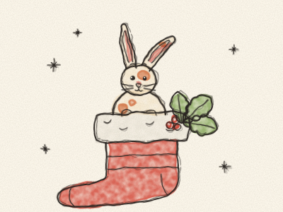
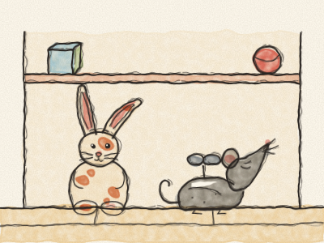
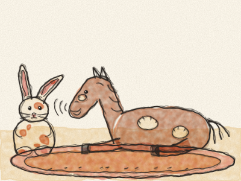
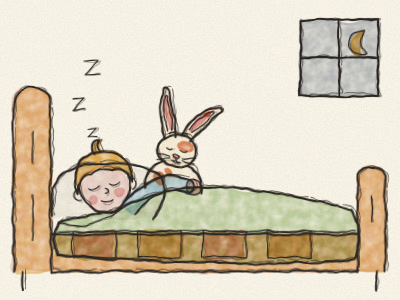
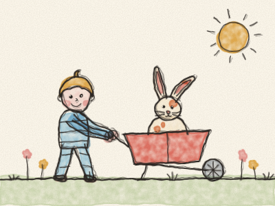
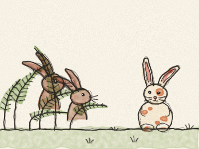
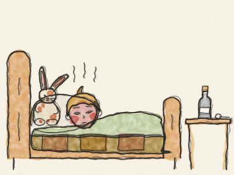
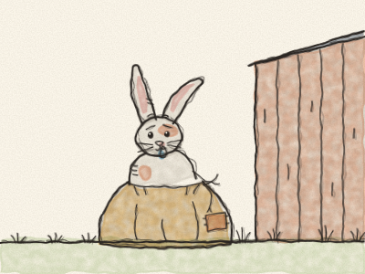
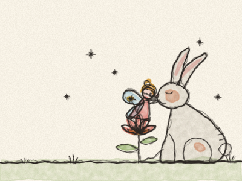

# O Coelho de Veludo

Era uma vez um coelho de veludo, e no princípio ele era mesmo esplêndido. Era gordinho e fofo, como um coelho deve ser. O pelo era malhado de castanho e branco, tinha bigodes verdadeiros feitos de linha, e as orelhas eram forradas de cetim cor-de-rosa. Na manhã de Natal, estava sentado mesmo no cimo da meia do Menino, com um raminho de azevinho entre as patas.

O Menino adorou-o — durante duas horas inteirinhas. Depois chegaram as tias e os tios para o almoço, houve um grande restolhar de papéis e fitas, e com tanta animação o Coelho de Veludo ficou esquecido.

Durante muito tempo viveu no armário dos brinquedos, ou no chão do quarto das crianças, e ninguém pensava muito nele. Os brinquedos mecânicos eram muito vaidosos. Tinham molas lá dentro e faziam *zzzz, zzzz, zzzz* quando se lhes dava corda.

— Tu só tens serradura lá dentro — disse o rato de corda, de nariz no ar. — Nem sequer tens uma chave. — E o Coelhinho sentiu-se muito pequenino e muito sem graça.

O único que era simpático com ele era o Cavalo de Pele. O Cavalo de Pele vivia no quarto das crianças há mais tempo do que qualquer outro. Era tão velho que o pelo castanho já tinha peladas, e quase todos os pelos da cauda lhe tinham sido arrancados para enfiar colares de contas. Mas era sábio.

— O que é ser Verdadeiro? — perguntou um dia o Coelho, quando estavam deitados lado a lado, perto da lareira. — Quer dizer ter coisas que zumbem cá dentro e uma manivela de fora?

— Ser Verdadeiro não tem a ver com a maneira como somos feitos — disse o Cavalo de Pele. — É uma coisa que nos acontece. Quando uma criança gosta de ti durante muito, muito tempo — não só para brincar, mas gosta de ti A SÉRIO —, então tornas-te Verdadeiro.

— E dói? — perguntou o Coelho.

— Às vezes — disse o Cavalo de Pele, porque dizia sempre a verdade. — Quando finalmente és Verdadeiro, já te gastaram quase o pelo todo de tanto gostarem de ti, os olhos caem e as costuras ficam frouxas. Mas isso não tem importância nenhuma, porque quando és Verdadeiro já não podes ser feio, a não ser para quem não percebe.

O Coelho suspirou. Também gostava de se tornar Verdadeiro, mas sem as partes desagradáveis.

Uma noite, o Menino não conseguiu encontrar o cão de porcelana que dormia sempre com ele. A Ama estava com pressa, por isso abriu o armário dos brinquedos e tirou a primeira coisa que encontrou. — Toma — disse ela —, leva o teu Coelhinho velho. Serve bem para dormir contigo! — E aconchegou o Coelho na cama do Menino.

Nessa noite, e em muitas noites a seguir, o Coelho de Veludo dormiu na cama do Menino. Ao princípio achou aquilo bastante desconfortável, porque o Menino o apertava com muita força, às vezes rebolava para cima dele, e às vezes empurrava-o tanto para debaixo da almofada que ele mal conseguia respirar. Mas depressa começou a gostar, porque o Menino falava com ele e fazia-lhe túneis lindos debaixo dos cobertores, como as tocas onde vivem os coelhos de verdade.

Chegou a primavera, e passaram dias compridos no jardim. Para onde quer que o Menino fosse, o Coelho ia também. Andava de carrinho de mão, fazia piqueniques na relva, e o Menino construía-lhe casinhas lindas debaixo das framboeseiras.

Estava tão feliz que nem reparou que o seu lindo pelo de veludo estava cada vez mais gasto, que a cauda se estava a descoser, e que o cor-de-rosa do nariz tinha desaparecido todo, ali onde o Menino lhe dava beijinhos.

Uma noite, o Menino deixou-o esquecido na relva, e a Ama teve de ir procurá-lo com uma vela, porque o Menino não conseguia adormecer sem ele. — Tanto alvoroço por causa de um brinquedo! — resmungou ela.

O Menino sentou-se na cama. — Ele não é um brinquedo — disse. — Ele é VERDADEIRO!

Quando o Coelhinho ouviu isto, ficou feliz, porque soube que aquilo que o Cavalo de Pele tinha dito era finalmente verdade. Nessa noite estava quase feliz demais para dormir.

Numa tarde de verão, enquanto o Menino brincava ali perto, dois coelhos estranhos saíram de entre os fetos altos. Eram castanhos, peludos e pareciam muito novos. Não se lhes viam as costuras, e mudavam de forma da maneira mais esquisita quando se mexiam.

— Porque é que não te levantas para brincar connosco? — disse um deles. — Sabes saltar nas patas de trás?

— Não me apetece — disse o Coelhinho, porque não queria que eles soubessem que não tinha patas de trás nenhumas, só uma peça lisa, como uma almofada de alfinetes.

O coelho bravo cheirou-o todo e deu um salto para trás. — Ele não cheira bem! — gritou. — Não é coelho nenhum! Não é verdadeiro! — E, *zás, zás*, desapareceram.

— Eu sou Verdadeiro! — disse o Coelhinho. — O Menino disse que sim! — E esperou muito tempo que eles voltassem, mas nunca mais voltaram.

Então, um dia, o Menino ficou doente. A cara dele ficou muito quente, e teve de ficar de cama durante muitos, muitos dias. O Coelhinho ficou sempre ao lado dele, debaixo dos cobertores, e segredava-lhe coisas sobre o jardim, as framboeseiras e todas as brincadeiras que iam fazer quando ele ficasse bom.

E, devagarinho, o Menino foi ficando melhor. O médico disse que ele devia ir para a praia respirar o ar fresco do mar. — Viva! — disse o Menino.

— Mas estes livros e brinquedos velhos têm de ir embora — disse o médico. — Estão cheios de micróbios.

Então puseram o Coelhinho num saco com uns livros de imagens velhos e levaram-no para o fundo do jardim, para trás do barracão. E nessa noite o Menino dormiu com um coelho novinho em folha, e estava tão entusiasmado com a praia que nem pensou no seu Coelhinho velho.

O Coelhinho remexeu-se até sair pela boca do saco e olhou à volta. Sentia-se muito sozinho. Pensou no Menino e nos longos dias de sol no jardim. «De que serve ser amado», pensou ele, «se tudo acaba assim?» E uma lágrima, uma lágrima verdadeira, escorreu-lhe pelo nariz de veludo gasto e caiu no chão.

E então aconteceu uma coisa estranha. Onde a lágrima tinha caído, nasceu uma flor — uma flor lindíssima, diferente de todas as outras do jardim. As pétalas abriram-se e de lá de dentro saiu uma fada pequenina, vestida de gotas de orvalho e luar.

Pegou no Coelhinho com cuidado ao colo e deu-lhe um beijinho no nariz de veludo. — Coelhinho — disse ela —, não sabes quem eu sou? Sou a Fada mágica dos quartos das crianças. Tomo conta de todos os brinquedos de que as crianças gostaram muito. Quando eles ficam velhos e gastos, venho buscá-los e torno-os Verdadeiros.

— Então eu não era Verdadeiro antes? — perguntou o Coelho.

— Eras Verdadeiro para o Menino — disse a Fada —, porque ele gostava de ti. Agora vais ser Verdadeiro para toda a gente.

Voou com ele até ao bosque, onde os coelhos bravos dançavam ao luar, e pousou-o na relva macia. — Vai correr e brincar, Coelhinho! — disse ela.

Ficou muito quieto por um momento. Depois sentiu uma comichão no nariz e, sem dar por isso, levantou uma pata de trás para se coçar. Tinha patas de trás! Verdadeiras! Deu um salto, *hop!*, e depois outro, *hop, hop!*, e lá foi ele com os outros coelhos. Era finalmente um Coelho Verdadeiro.

Passou o outono, e o inverno. Na primavera, quando o Menino voltou a brincar no jardim, dois coelhos saíram de entre os fetos para olhar para ele. Um deles tinha manchas castanhas e brancas, e havia qualquer coisa nos olhos dele que parecia muito familiar.

«Olha», pensou o Menino, «é mesmo parecido com o meu Coelhinho velho!»

Mas nunca soube que era mesmo o seu Coelhinho, que tinha voltado para ver a criança que primeiro o tinha ajudado a ser Verdadeiro.

> É o amor que nos torna Verdadeiros. Aquilo de que mais gostamos nunca é feio, por mais gasto que esteja.
